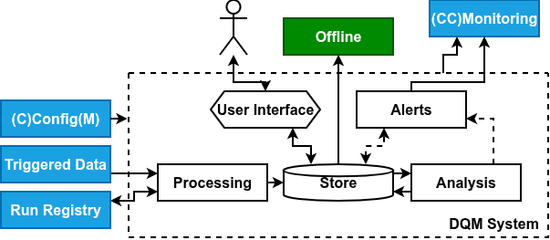
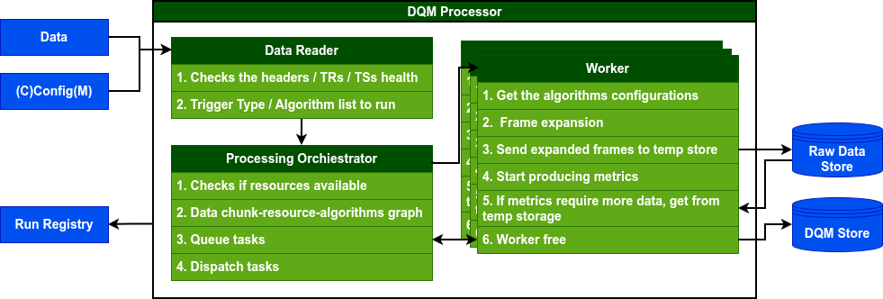
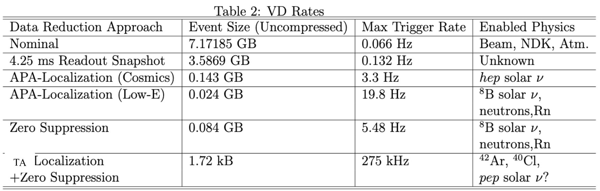

## Processing subsystem scope
The scope of the processing subsystem is to produce DQM metrics and send them to the store. It does not compare them against any thresholds (Analysis subsystem), and does not create any alerts on pre-set logic (Alerts subsystem).
 
As such, it has to be able to open the data file (which could contain TriggerRecords or TimeSlices), recognise various data types (E.g. WIBethFrames, TriggerPrimitives), and be able to run various DQM algorithms on that data.

DQM Processing will be one of the heaver processes done by the DQM, and will need to be parallelized amongst multiple CPU cores, and distributed among multiple servers.

## IO
### Input sources
* User-provided .hdf5 file (initial)
* .hdf5 file discovered from drive (later)
* DataFlow (before operations)

### Input data types
* TriggerRecods
	* WIBEthFrame
	* TDEEthFrame
	* DAPHNEFrame
	* TriggerPrimitive (TPC, maybe PDS in the future?)
	* TriggerActivity
	* TriggerCandidate
	* TR/Fragments Headers
* TimeSlices
	* TriggerPrimitive (TPC, maybe PDS in the future?)
	* TR/Fragments Headers
	* (Maybe in the future) TriggerActivity
	* (Maybe in the future) TriggerCandidate

### Output data types
* Bool per metric (single bool), e.g. header check per file.
* Float per metric (single float), e.g. RMS on wire
* Histogram per metric (2 vectors of floats), e.g. FFT spectrum
  - Can be optimized, e.g. binning can be represented by 3(2) numbers if uniform.
  - Can be optimized, e.g. binning extracted from configuration, no need for each metric sent.

## Interactions
### Triggered Data -> Processing
### Configuration -> Processing
### Processing -> Run Registry
### Processing <-> Store

## Processing types
1. DQM-trigger processed at regular intervals.
	- Some metrics could be processed at different intervals, e.g. FFT/channel less frequently than RMS/channel.
    - Frequent, should be fast and therefore simple.
    - DQM trigger rates to be tuned during commissioning.

2. Physics triggers processed at irregular intervals.
    - Some Physics triggers selected for event display (EVD).
    - Semi-frequent, rates unknown (depends on trigger thresholds/ROI, see [Physics Rates](#physics-rates) section.

3. Physics triggers selected for the Event Display.
	- EVD triggers could be processed by more/different algorithms.
		- E.g. time distribution? TOT distributions? ADC histograms?
	- Semi-frequent, *probably* no more than 1/minute.

4. Processing user-requested .hdf5 files, very irregular intervals, potentially not-default algorithms
    - E.g. daq expert is interested in more detailed metrics for recent random snapshot.
    - Very infrequent, could be slower/more processing involved.
    - **Need to think about online DQM / offline DQM boundary here too.**

## Parallelisation
Spatial and algorithmic level of parallelisation depends on the metrics needed to be calculated. It is likely that data from a single trigger will be distributed on multiple servers for DQM processing, and "which data chunk goes to which server-worker" might depend on the level of spatial cross-correlation needed (e.g. making metrics looking at correlations between two APAs requires single core to access data from both APAs).
### Spatial parallelisation
Each raw fragment contains data from one WIB (512 channels), AMC (64 channels) or DAPHNE, with fragments across whole readout window. TPs are bundled on per-{APA,CRP}plane level, TAs on per-APA/CRP level.

Raw data has to be "expanded" for TPC, and can be converted into some form of 2D vector/container. From there we can:

1. Process each channel on separate thread.
    - Won't allow correlating channels during metric calculation.
    - We don't have enough CPUs (>0.5M) to take the advantage of this.
2. Process each Fragment on separate thread.
    - Allows channels within WIBEthFrame|TDEEthFrame/DAPHNEFrame to be correlated during the metric calculation.
    - Easy: data already packed in similar format.
    - We don't have enough CPUs (>5k) to take the advantage of this.
3. Process each APA/CRP on separate thread.
    - Allows channels across APA/CRP to be correlated during the metric calculation.
    - Similar number of parallel tasks to the number of CPUs.
4. Process whole detector on one CPU.
    - Allows serious cross-correlations between channels across the whole detector during the metric calculation.
    - Could be parallelised (algorithm-dependent) if on single CPU with multiple cores.
    - Slow.
5. Other: WIB, FEMB, COLDATAs, ColdADC, planes, AMC, Crate/Chimney
	- The level of data granularity might be different for different metrics.
	- Coherent-noise studies might require granularity at FEMB/ColdADC etc. level.
6. Different levels of spatial cross-correlation for different metrics might require multiple levels of data granularity & its splitting, so many of the above might need to be supported.
    - Some orchestrator would need to prepare a list of tasks to process, linking different spatial channel-groups with data types (e.g raw + TPs) with algorithms.
    - These tasks would then be dispatched to parallel processing units (threads, cores, CPUs).
    - Similar to systems in game engines, minus the "task dependency tree".

Multiple levels of parallelisation might be needed for different processing types.
E.g. DQM-Trigger could be processed in parallel on lower level (channel, WIB, APA) than Physics triggers (APA, Detector) or user-requested (Detector).

### Algorithmic parallelisation
In principle each algorithm could be executed in parallel, adding another level of threading if needed. This could be useful if data-spacial parallelisation difficult, e.g. for metric where metrics spatially cross-correlated across whole detector are needed, point 4 in [[#Spatial parallelisation]].

- Efficient algorithmic parallelisation might require cloning the data for each algorithm, increasing memory demands.
- Using pointers to the data instead will cause L3 cache misses, slowing the algorithms down.
- Non-parallelised trigger-like option: Iterate over frame's ticks. For each tick, execute each algorithm sequentially. "Frame/Algorithm start" and "Frame/Algorithm end" might need to be sent to each algorithm for this to work. Fewer cache misses, but no parallelisation. Unclear if works for FFTs.

## Configuration
Detailed configuration of algorithms could be a separate document / section. Not only which algorithm to run, but e.g. algorithm-specific config (e.g. frequency granularity for FFT) and even spatial (e.g. RMS for entire WIB vs channel-by-channel).

### Components to configure
- Which algorithms should be run. 
	- E.g. different for DQMTrigger vs PhysicsTrigger vs EVDTrigger. 
	- User might want to provide custom cfg while providing file to re-process.
- Channel maps/masks.
	- Channel map should not change often (or at all), but channel mask might change relatively often as channels go offline.
	- Channel mask used to mask out e.g. bad flag production.
	- Shall user be allowed to provide a channel mask with a file, or channel mask always grabbed from some archival of run config? E.g. what if user provides whole trigger file, but wants only APA2?
- DQM Trigger rate is a Trigger configuration, not DQM.
- Which servers/connections/CPUs are available for DQM processing, UI, EVD, etc? This may change sometimes, and should be provided via config.
	- Number of threads to spawn, on which machines, for what kinds of tasks, etc.

### Configuration streams
- Persistent configuration for the DQM-trigger.
	- Can be either configured once and "persist", or grab a "default" configuration objects for each DQMTrigger.
- Other triggers might require different configs, e.g. Calibration run and Physics triggers might want more involved / different DQM.
	- Default algorithm configurations for specific trigger types?
- The channel masks should be still dependent on run. We need access to some conditions database for this.
- User-provided files: avoid OKS if possible. Or rather: make user-facing interface simple (e.g. flags to exe for specific algos), even if behind-the-scenes OKS is still used.
	- That will let user modify algorithm if needed.
	- E.g. user wants FFT to have finer frequency intervals.
- User-provided files: script that enables "User-driven DQM" should have options:
	- Do not store in offline (but online store might be OK)
	- Do not use for Analysis / Alerts
	- Dump diagnostics into a separate file (esp. installation?)
	- Alternatively: Store everything online & offline (default?), but have flags for do not use in analysis / alerts.
		- That way users can always access custom runs offline if needed, processed data never lost.

## Orchestration
### Data distribution across Processing
- Data from .hdf5 files will come from the entire detector. ~few GB worth of raw TPC/PDS data, complex trigger objects etc.
- Some DQM component should be able to read this file, split it into chunks, and send for processing.
- That component could be the one that does checks on the TR/TS header too.
- To consider:
	  - We only want to do frame expansion once per WIBEthFrame, not per algorithm. Some pre-processing needed.
	  - Trigger objects could have different spatial level of parallelism.
	  - Can we have metrics that mix raw signal with trigger objects? E.g. WIBEthFrames with TA/TPs? If so, that can make design of Processing more difficult.
### Resource-aware orchestration
- Scenario: DQM trigger is being processed, two physics triggers happen close in time, and DAQ expert submits a file to process by DQM with more detailed algorithms, all at the same time.
	- DQM cannot crash.
	- DQM cannot slow down any other DAQ subsystems (DFO, Readout, Trigger etc)
	- At most, DQM could request lower DQM-trigger rates for the next few minutes?
- Simple resource orchestrator. A queue of tasks/triggers to process, linking it with which resources are currently occupied.
    - Queue of tasks, but per CPU/server? Think memory locality too.
- Could allocate e.g. fraction of resources for one type of input/source/trigger, and another fraction for another? E.g. Processors for DQM-triggers have dedicated resources.
- Split resources into two:
	 1. DQMTrigger: stable rates, can keep CPUs at >90% non-stop.
	 2. Other: Physics trigger rates unreliable. Need extra room for e.g. massive showers, supernovae, and other event rate spikes. Can use that headroom for user-provided triggers too.
- Efficient task packaging needed.
	- E.g. a task is a subdetector - datatype(s) - Algorithm(s) combination.
	- Memory locality: send the data to thread once, process multiple times (algorithms). May be difficult for data where multiple types needed (e.g. raw data + TAs)

## Design / Shape

DQM processing will need to perform three major operations:
1. Read the data, understanding what it is, and doing checks on the file/object headers.
2. Create processing tasks that link the data chunks with the algorithms to be run, and pair those with available resources.
3. Run the DQM algorithms on those data chunks to produce DQM metrics, and store them in a DQM store. Some of the raw data needs to be stored in Raw Data Store, so it's available for event display and potential cross-correlated metrics.

### Data Reader

#### Receive
- Data to process, whether in HDF5 format (user-provided or from some automatic task), or in TriggerRecord/TimeSlice (directly from DataFlow).
- Configuration, detailing the algorithms to run, conditions, channel masks etc. Information can be pulled from some from of run registry to.

#### Processing
- Check file headers, TR headers, TS headers, fragment headers etc. Effectively simple checks on file/object integrity.

#### Send
- Data/file pointers, and configurations to use with that data.
- This does not need to be "send over network". Data Reader could be an object within Processing Orchestrator application, _returning_ these pointers/configurations.
- Operational status to the CCM. E.g. how many data chunks received since last operational message?

### Processing Orchestrator
#### Receive
- TR/TS pointers, with list of data types to process.
- A list of algorithm & algorithm configurations to run on that data.

#### Processing
- Checks list of resources that these data should be run on.
- Create a graph of parallel tasks (lets call it a job) to execute.
	- Each parallel task is a (data chunk, worker) combination, with a list of algorithms bundled to run on it and any relevant configuration.
- Check if the resources are available.
- Puts a job (whole graph) into a queue. Sends tasks from the top job as resources become available. Once tasks in job completed, move on to the next job in the queue.

#### Send
- Tasks (data chunk - worker - algorithms combo) to available Workers.
- Once job completed, send message to the run registry, notifying which trigger was processed.
- Operational status to the CCM. E.g. how many data chunks received since last operational message? How many jobs successfully processed? How large is the job queue?

### Worker
#### Receive
- Pings from the orchestrator to see if the worker is currently doing any processing.
- Bundled (data chunk, algorithms) to run on that worker, with any relevant configuration.

#### Processing
- Set the "work in progress" flag to true.
- Get the algorithm configuration objects and create a list of algorithms to run on the data.
	- Might need time-priority, e.g. simple/fast metrics first, FFT/long metrics last.
- If raw data, do the frame expansion first.
- Some TR/data might need to be sent to temporary storage, for e.g. event display purposes.
- Start producing the metrics. If worker has multiple available cores (unlikely?), can distribute algorithms across cores, or run some algorithms on multiple cores simultaneously.
- If unavailable data needed for e.g. cross-correlated metrics, get them from the store.
- Publish the computed metrics.
- Set the "work in progress" flag to false.

#### Send
- Responses to the orchestrator saying if the worker is free or not.
- Data to the temporary store (e.g. expanded frames, TPs, etc).
- Computed DQM metrics into the DQM store (e.g. by publishing).

## Physics Rates
- Trigger rates are going to be stochastic, and dependent on various factors including level of ROI, disk space, max disk writing rates, physics performance of the algorithms, etc.
- Given the table below from Josh Klein (TDR? Trigger requirements doc?), it suggests we might have **~0.5GBps throughput of physics triggers**.

## Open Questions
- Level of correlation between channels/WIBs/APAs: drives maximum level of parallelization possible.
	- From TDE: no correlated metrics needed. Noise evaluated "by eye" with correct display views.
	- From BDE: cross-correlated metrics between channels within FEMB, WIB, WIEC, crate etc. CRP to CRP correlations interesting too.
	- EVD becomes relatively high priority.
	- Perhaps higher than DQM display?
- Granularity of the data (APA/trigger, detector/trigger): drives maximum level of parallelization and level of correlation possible.

## TODO
#### Interactions
* Sampling/data input
* Telling Run Registry we processed the data
* Sending the processed metrics to the store
* Receiving a configuration for the DQM (which algorithms, channel masks, etc)
* Sending DQM operational health metrics to CCM
